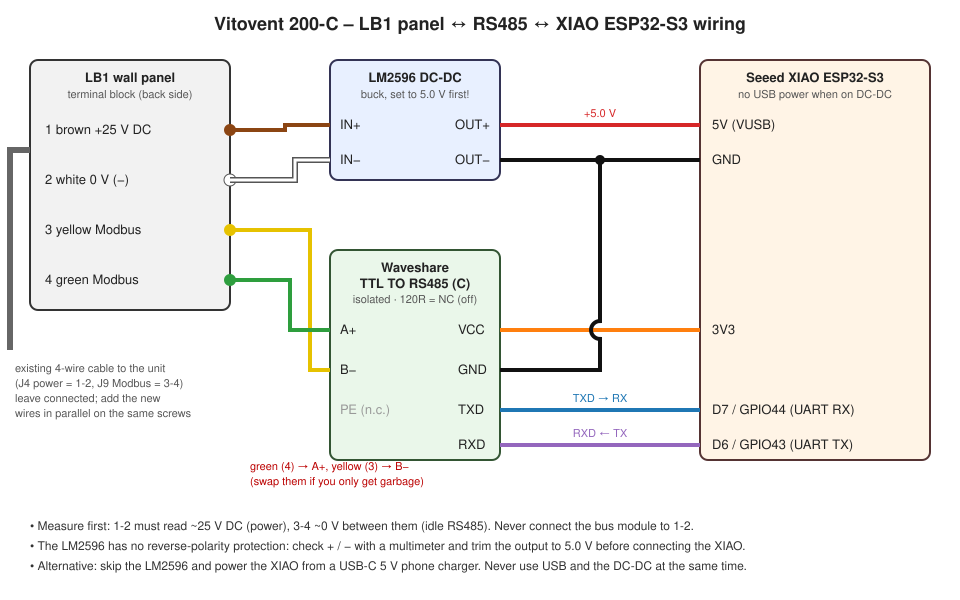

# Hardware and wiring

## Parts

| Part | Notes |
|---|---|
| Seeed Studio **XIAO ESP32-S3** | any ESP32 works; pins below are for the XIAO S3 (check the chip: a C6 build will not boot on an S3) |
| **Waveshare TTL TO RS485 (C)** | galvanically isolated, 3.3 V logic, automatic direction control, screw terminals on both sides |
| **LM2596 DC-DC buck converter** (optional) | powers the XIAO from the panel's 25 V supply, so no USB charger is needed |
| or a USB-C 5 V phone charger | simplest power option |
| Short wires, multimeter, small screwdriver | |

## 1. LB1 panel terminal block

The LB1 is clipped onto a wall base. Switch the unit off, pull the bottom edge of the panel slightly forward and lift it up. Behind it there is a 4-way terminal block with the cable coming from the unit:

| Terminal | Wire colour | Function | Measured |
|---|---|---|---|
| 1 | brown | +25 V DC supply for the panel | 1 (+) ↔ 2 (−): **~25 V** |
| 2 | white | 0 V (−) | |
| 3 | yellow | RS485 / Modbus | 3 ↔ 4: **~0 V** (idle bus); 1 ↔ 3 and 1 ↔ 4: ~23 V |
| 4 | green | RS485 / Modbus | |

At the unit end the cable goes to plug **J4** (power) and **J9** (Modbus) on the Vitovent control board (LB1 manual, p. 10–11). The colour order in the manual is GN YE WH BN.

**Always measure before connecting.** The pair with a steady ~25 V is the power supply. The other pair is the data bus. Connecting the RS485 module to the power pair is the only realistic way to damage something.

## 2. RS485 module ↔ panel (bus side)

Connect in **parallel**: loosen the screw, add the new wire next to the existing one, tighten, and pull gently to check that both are clamped. Do not disconnect the original wires.

| LB1 terminal | Wire | Waveshare RS485 side |
|---|---|---|
| 4 | green | **A+** |
| 3 | yellow | **B−** |
| – | – | PE: not connected (insulate the end) |

On this installation the polarity is green = A+, yellow = B−. If the decoded bytes are mostly `FE`, `FA`, `FF` (or the frames never pass the CRC check), A and B are swapped: exchange the two wires **on the Waveshare terminals**. Swapping is harmless.

**120 Ω termination:** must be **off**. On the (C) version there is no switch: the resistor marked `121` next to the `120R` / `NC` silkscreen is not connected from the factory. Check with a multimeter between A+ and B− with the module unpowered: `OL` / several kΩ = off (correct), ~120 Ω = on (wrong).

## 3. RS485 module ↔ XIAO (TTL side)

| Waveshare TTL side | XIAO ESP32-S3 |
|---|---|
| VCC | **3V3** |
| GND | **GND** |
| TXD | **D7** (GPIO44, UART RX) |
| RXD | **D6** (GPIO43, UART TX) |

ESPHome logs go over the native USB (`hardware_uart: USB_SERIAL_JTAG`), so the hardware UART is free for the bus. If you get no data at all, try swapping TXD/RXD.

Tip: if flashing over USB fails, hold **B** (BOOT), tap **R** (RESET), release B, and/or disconnect the Waveshare while flashing (D6/D7 are also the chip's boot UART). After the first flash, updates go over Wi-Fi.

## 4. Power

### Option A – from the panel supply with an LM2596 (no USB charger)

| From | To |
|---|---|
| LB1 terminal 1 (brown, +25 V) | LM2596 **IN+** |
| LB1 terminal 2 (white, 0 V) | LM2596 **IN−** |
| LM2596 **OUT+** (5.0 V) | XIAO **5V** (VUSB pin) |
| LM2596 **OUT−** | XIAO **GND** |

1. Check the polarity of 1/2 with the multimeter: the LM2596 has **no reverse-polarity protection**.
2. Power only the LM2596 and turn its trimmer until the output reads **5.0 V**. Out of the box it can output much more and would destroy the XIAO.
3. Then connect the XIAO. Feed 5 V into the 5V pin, not 3V3: the XIAO's own regulator makes 3.3 V, which also powers the Waveshare.
4. Never connect USB and the LM2596 at the same time.

The XIAO + Waveshare draw roughly 30–50 mA from the 25 V line, which also powers the LB1. On this installation the panel works normally; if your display flickers or reboots, disconnect and use option B.

### Option B – USB-C 5 V charger

Plug a phone charger into the XIAO's USB-C port. Fully independent from the unit.
